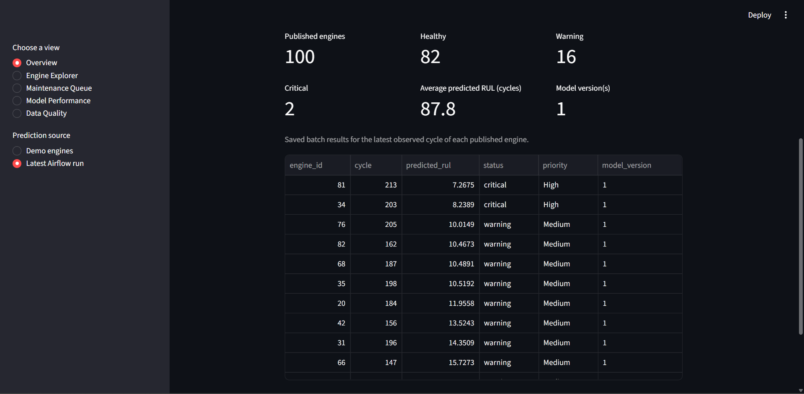
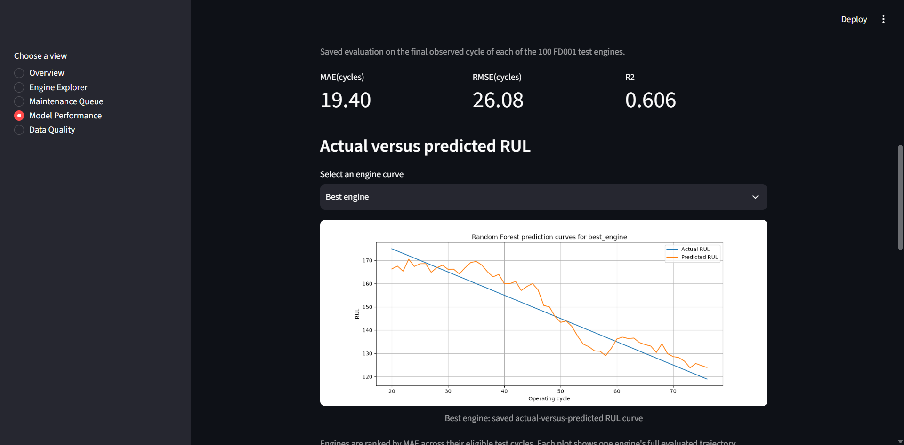
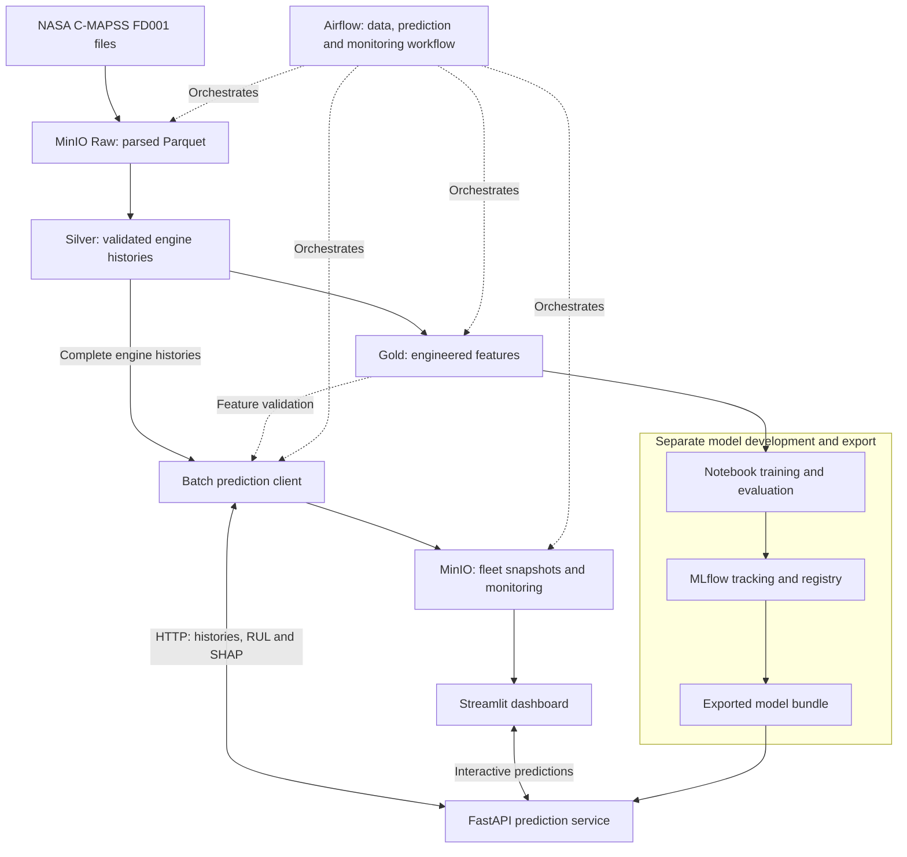

# Industrial Predictive Maintenance MLOps Platform

[](https://github.com/just-badr00/industrial-predictive-maintenance/actions/workflows/ci.yml)

An educational MLOps platform that predicts engine Remaining Useful Life
(RUL) using NASA C-MAPSS FD001 sensor histories. It connects validated
industrial data to model serving, monitoring, and maintenance dashboards.

**Python · pandas · MinIO · scikit-learn · MLflow · FastAPI · SHAP · Airflow · Streamlit · Docker**

The platform combines leakage-safe feature engineering, a registered Random
Forest model, API predictions with SHAP explanations, a ten-task Airflow
workflow, monitoring, and GitHub Actions checks.

## Dashboard preview



The Overview displays saved predictions from the latest published Airflow
run, one result per engine at its latest observed cycle. The supplied
screenshot shows 100 engines, their health categories, predicted RUL, and
maintenance priorities. It is a saved benchmark snapshot, not a live fleet.

## Model results

The selected Random Forest achieved **MAE 19.40 cycles** and **RMSE 26.08
cycles** at the final observed cycle of each of the **100 official FD001
test engines**.

| Evaluation scope | Observations | MAE (cycles) | RMSE (cycles) | R² |
|---|---:|---:|---:|---:|
| Final observed cycle per official test engine | 100 | 19.40 | 26.08 | 0.6063 |
| All eligible official-test cycles | 11,196 | 31.51 | 41.75 | 0.4436 |

These are different evaluation scopes. The endpoint benchmark uses one
observation per engine; the all-cycle evaluation includes each eligible
cycle and gives longer histories more observations.



The curve illustrates the selected **best engine** across its evaluated
history. It is not an aggregate curve or a representative-error claim for
all 100 engines. The headline metrics summarize the endpoint benchmark.

## Architecture



Airflow runs data preparation, validation, API-based batch inference,
monitoring, and dashboard publication. Training, model registration, and
export are separate steps; the DAG does not automatically retrain or
promote models. FastAPI computes inference features from complete engine
histories and loads the exported model once at startup. Docker Compose
coordinates the local services.

See [the project contract](docs/project_contract.md) for the full prediction
interface, evaluation rules, architecture, and limitations. The project uses
simulated benchmark data and is intended for education and portfolio use.

## Repository layout

| Path | Contents |
|---|---|
| `src/` | Ingestion, validation, transformations, inference, API and monitoring |
| `notebooks/` | Dataset exploration, feature development, training and model analysis |
| `tests/` | Automated validation, pipeline, API and monitoring tests |
| `api/` | API image definition and serving dependencies |
| `dashboard/` | Streamlit application, image definition and dependencies |
| `airflow/` | DAG, Airflow image and DAG-loading check |
| `mlflow/` | MLflow image and initial database-preparation utilities |
| `docs/` | Maintained project contract and runnable API example payloads |
| `.github/workflows/` | Continuous integration checks |

Dataset files, experiment artifacts, generated outputs and runtime
configuration are supplied locally rather than committed.

## Local deployment

The root `docker-compose.yaml` coordinates:

- PostgreSQL for Airflow metadata.
- MinIO for datasets, manifests and monitoring reports.
- Airflow initialization, API server, scheduler and DAG processor.
- MLflow for saved experiments and registered models.
- FastAPI for predictions.
- Streamlit for the dashboard.

This deployment reuses prepared project data and artifacts.
A fresh Git clone alone does not contain everything needed to run it.

## Required local resources

Before startup, supply:

- Docker Desktop running Linux containers.
- A `.env` file with valid settings; see `.env.example`.
- FD001 files in `CMAPSSData`: `train_FD001.txt`, `test_FD001.txt`
  and `RUL_FD001.txt`.
- The exported model bundle in `output/serving_model`, including
  the `model` folder and both metadata JSON files.
- The prepared Docker MLflow database at `output/docker_mlflow/mlflow.db`.
- Historical artifact files under the existing `mlruns` directories.
- Existing Docker volumes `minio_cmapss_data` and
  `cmapss-airflow_postgres-data`.

The MinIO volume must contain the project bucket and historical training
Gold run referenced by the serving model's metadata. Creating an empty
volume does not restore this data.

Data files, credentials, databases and model artifacts are excluded from Git.

## MLflow database preparation

The preparation scripts are specific to the original Windows project path.
Review their paths before using them elsewhere.

For initial preparation only:

```powershell
python mlflow/prepare_database.py
python mlflow/update_artifact_paths.py
```

The first script copies the original database and refuses to overwrite an
existing Docker copy. The second changes artifact addresses in that copy
to use `/opt/cmapss`.

The original database is preserved. Subsequent changes to it are not
automatically synchronized to the Docker copy.

## Start and stop

Run commands from the project root.

Validate configuration:

```powershell
docker compose config --quiet
```

Build images and start services:

```powershell
docker compose up -d --build
```

Start again using existing images:

```powershell
docker compose up -d --no-build
```

Inspect status and logs:

```powershell
docker compose ps -a
docker compose logs --tail 50
```

Stop services:

```powershell
docker compose stop
```

`airflow-init` finishing with exit code 0 is expected.
Startup does not automatically trigger the prediction DAG.

Keep the previous standalone deployment stopped when using this stack:
it shares ports and persistent storage with this deployment.

## Browser addresses

| Interface | Address |
|---|---|
| Streamlit | http://localhost:8502 |
| FastAPI documentation | http://localhost:8001/docs |
| MLflow | http://localhost:5001 |
| Airflow | http://localhost:8081 |
| MinIO console | http://localhost:9011 |

Airflow uses the configured `badr` account. Its generated password file is
under `airflow/config`; credentials must not be committed.

## Run the pipeline

Open Airflow and trigger a new manual run of `cmapss_data_prediction`.

The ten-task workflow is:

```text
check_source_data -> ingest_raw_data -> monitor_raw_quality
  -> transform_to_silver -> generate_features -> validate_features
  -> monitor_feature_drift -> predict_current_health
  -> monitor_model -> publish_dashboard_dataset
```

Unpause the DAG if necessary and trigger a new manual run. In the Airflow
UI, select a task and open its Logs to inspect progress or failures. The
prediction task prints progress from `Predicted 10/100 test engines.` to
`100/100`. A failed upstream task blocks dependent tasks. Storage/network
tasks have one retry after 30 seconds; source and feature validation tasks
have no retries.

After success, open Streamlit and select Overview → Latest Airflow run.
Refresh the page to retrieve the latest published snapshot.

Selecting a stored snapshot does not call the prediction API or trigger a
DAG run. The workflow does not retrain or promote models. Engine Explorer
remains an interactive three-engine demonstration.

Each run stores a manifest at
`metadata/etl_metadata/load_date=<date>/run_id=<run-id>/manifest.parquet`.
Gold `maintenance_predictions` and `current_engine_health` each contain one
row per test engine. The three monitoring reports are stored under
`monitoring/data_quality/`, `monitoring/data_drift/` and `monitoring/model/`
with the same date and run ID. Model benchmark accuracy is evaluated at
the final observed cycle per engine; it is distinct from all-cycle metrics.

Use a new manual run for a fresh execution. Retrying a task normally reuses
its run partition. Avoid changing source files during a run. Manifest
updates are not multi-object transactions; failed uploads can leave partial
objects without successful publication records.

## Prediction API

| Method and route | Purpose |
|---|---|
| `GET /health` | Check that the API has a loaded model |
| `GET /model-info` | Retrieve model version and training/data lineage |
| `POST /predict` | Predict the current RUL of one engine |
| `POST /predict/batch` | Predict the current RUL of several engines |

Use the interactive documentation with the complete payloads in
`docs/examples/predict_engine_1.json` and
`docs/examples/predict_batch_engines_1_2_3.json`.

Submit every observed cycle from cycle 1 through the current cycle, in
order without gaps, with at least 20 observations. Each observation needs
its cycle, three operational settings and all 21 sensors. The API computes
features and selects the saved 137 model inputs in training order. A
trailing 20-row segment is insufficient because EMA retains earlier history.

Responses include RUL, status, model version and three signed SHAP factors.
Critical means RUL <= 10, warning means 10 < RUL <= 30, and healthy means
RUL > 30. Factors describe model contributions, not physical diagnoses.
Invalid requests normally return HTTP 422. A stopped service produces a
connection failure rather than an HTTP response.

The API image contains source code, while `output/serving_model` is mounted
read-only at `/model`. The model and SHAP explainer load once at startup.
The container uses the exported bundle without consulting the Windows
registry database. Initial export uses `python -m src.modeling.export_model`
from the project root and refuses to overwrite an existing bundle. Do not
rerun the exporter merely to restart services.

## Updating and troubleshooting services

Inspect one service's logs with, for example:

```powershell
docker compose logs --tail 60 api
docker compose logs --tail 60 airflow-scheduler airflow-dag-processor airflow-apiserver
```

Image-copied code changes require a rebuild and container replacement:

```powershell
docker compose up -d --build api streamlit
```

Mounted files are visible without rebuilding an image, but changing a DAG
does not rerun it automatically. The API keeps its loaded model in memory;
restart it after deliberately replacing a compatible serving bundle.

The external MinIO and PostgreSQL volumes retain their data across normal
container replacement. The original standalone deployment and the root
Compose stack must not use those volumes simultaneously.

## Automated checks

GitHub Actions installs `requirements-test.txt`, runs Ruff F821/F823 and
pytest, checks real Airflow DAG loading, builds all four custom images and
validates Compose using placeholder settings. It does not deploy services.

In a supported Python 3.14 environment, the equivalent test setup is:

```text
python -m pip install -r requirements-test.txt
python -m pytest tests -q
```

Tests use controlled model/storage/API substitutes and the committed JSON
examples; they do not require the running platform or production artifacts.
The feature-equivalence test also reads the final feature-engineering
notebook. The verified full-suite environment is Linux/CI. Windows Smart
App Control has previously blocked a compiled scikit-learn component during
collection; a dependency installation does not remove that policy block.

## Scope

This is a local educational system using simulated benchmark data.
Monitoring covers the documented project scope; it is not a certified
aircraft-maintenance system.

The deployment reuses prepared local state. Database preparation currently
uses the original Windows paths, and dependencies/base images are not a
complete immutable lock. Clean-machine bootstrap, automated training,
release publishing and cloud deployment are outside this implementation.
